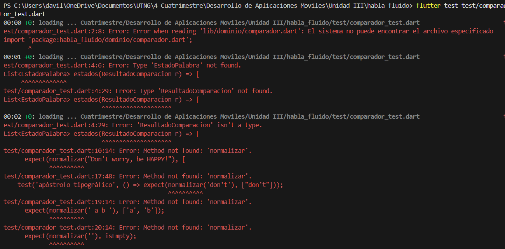
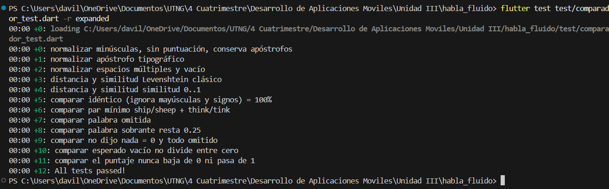
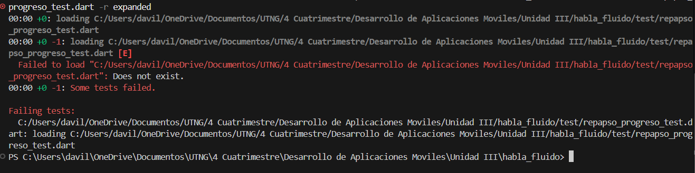
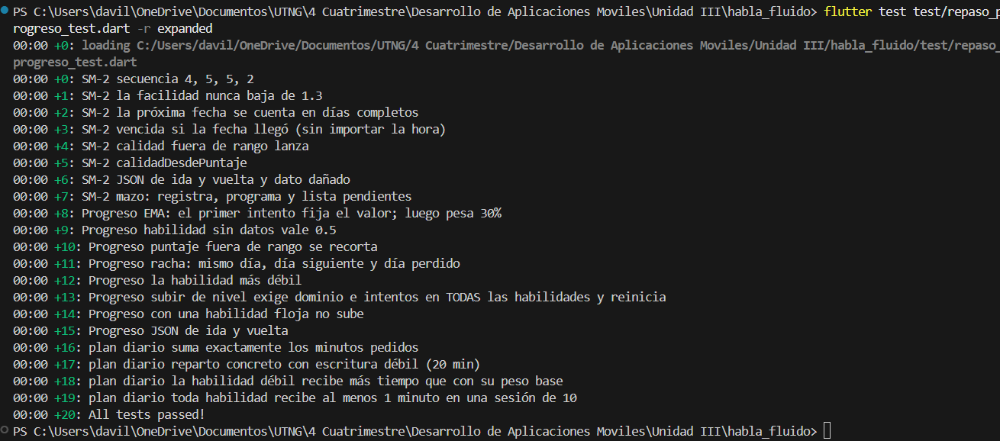
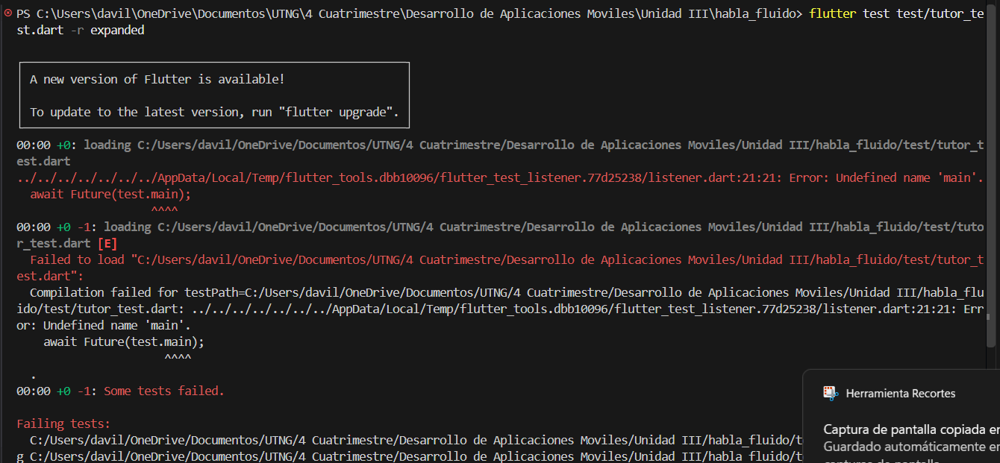
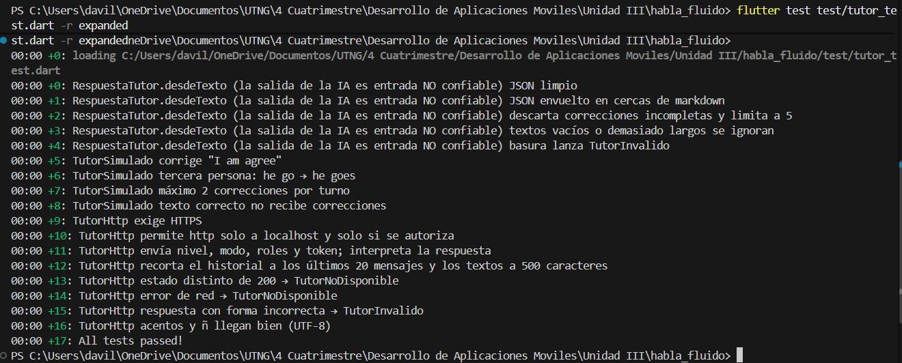
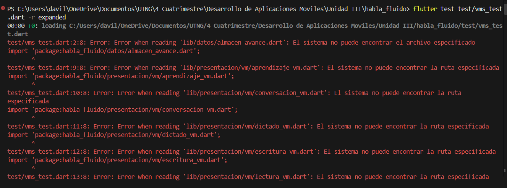
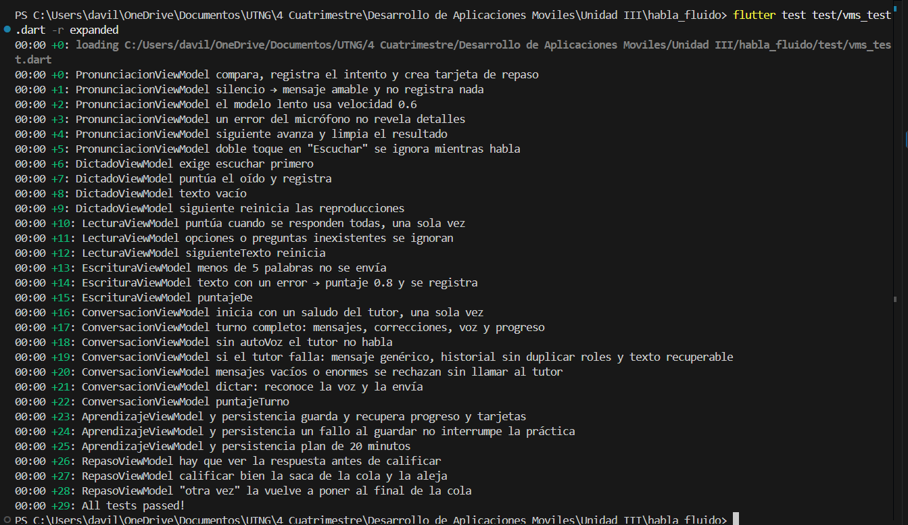
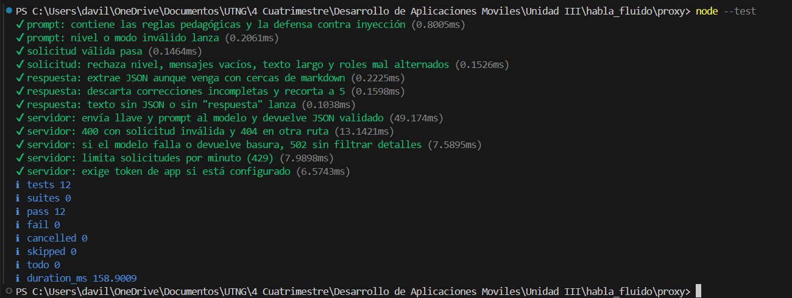
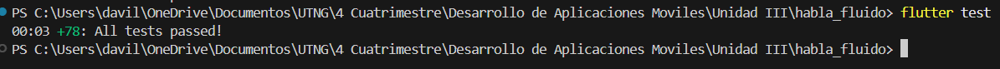

# Habla Fluido

---

## 1. Comparador (Ronda 2)

Rojo: la prueba falla antes de implementar la lógica del comparador[cite: 2].

[cite: 2]

Verde: pasan las pruebas del comparador[cite: 2].

[cite: 2]

---

## 2. Repaso y progreso (Ronda 3)

Rojo: la prueba falla antes de implementar el flujo de repaso y progreso[cite: 2].

[cite: 2]

Verde: pasan las pruebas de repaso y progreso[cite: 2].

[cite: 2]

---

## 3. Tutor (Ronda 7)

Rojo: la prueba falla antes de implementar la lógica del tutor[cite: 2].

[cite: 2]

Verde: pasan las pruebas del tutor[cite: 2].

[cite: 2]

---

## 4. ViewModels (Ronda 9)

Rojo: la prueba falla antes de implementar los ViewModels[cite: 2].

[cite: 2]

Verde: pasan las pruebas de los ViewModels[cite: 2].

[cite: 2]

---

## 5. Pruebas de proxy y resultado final

Pruebas de proxy:

[cite: 2]

Verde: pasan todas las pruebas del proyecto con `flutter test`[cite: 2].

[cite: 2]

## Pantallas funcionando

<table>
  <tr>
    <td align="center">
      
      
<strong>Pantalla 1</strong>

    </td>
    <td align="center">
      
      
<strong>Pantalla 2</strong>

    </td>
    <td align="center">
      
      
<strong>Pantalla 3</strong>

    </td>
  </tr>
  <tr>
    <td align="center">
      
      
<strong>Pantalla 4</strong>

    </td>
    <td align="center">
      
      
<strong>Pantalla 5</strong>

    </td>
    <td align="center">
      
      
<strong>Pantalla 6</strong>

    </td>
  </tr>
</table>
